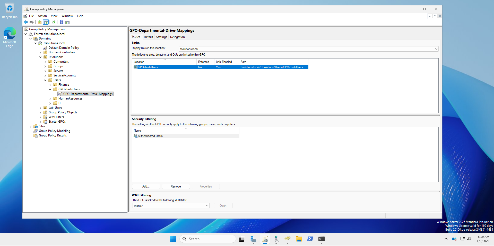
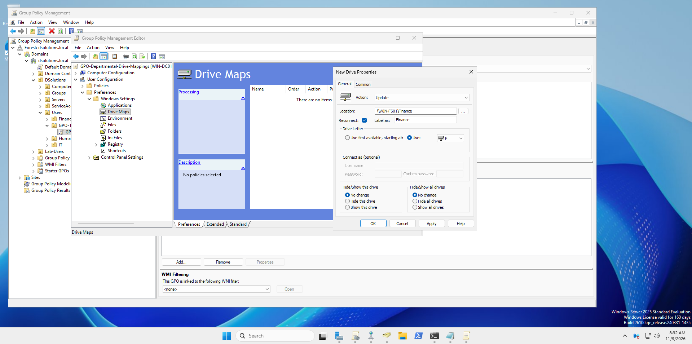
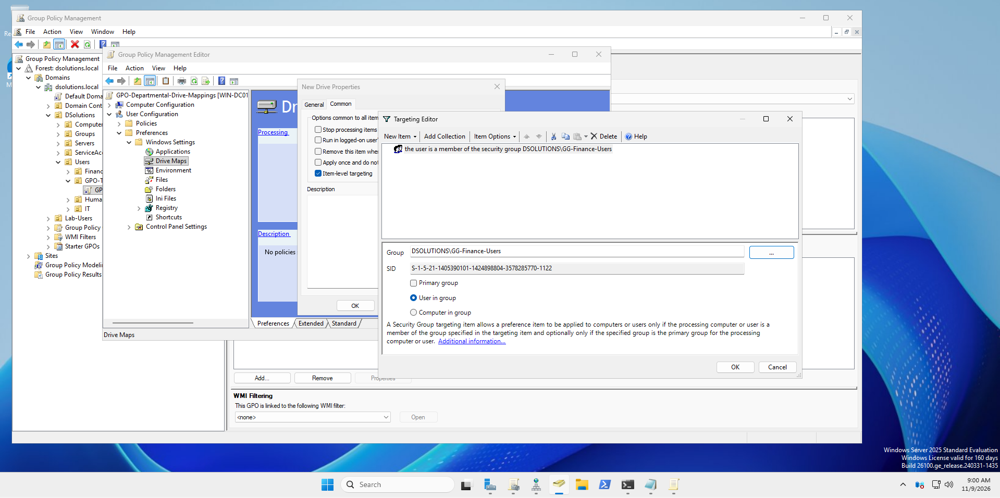
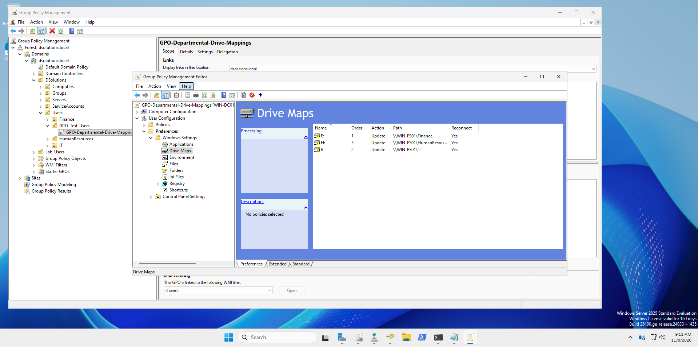
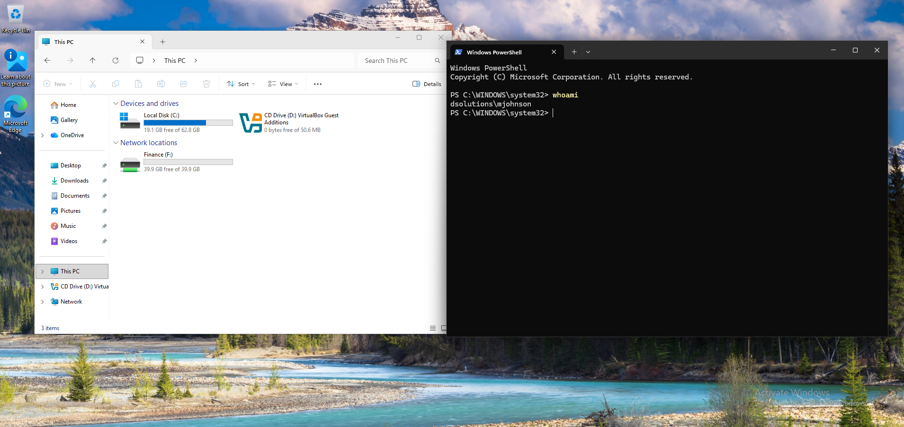
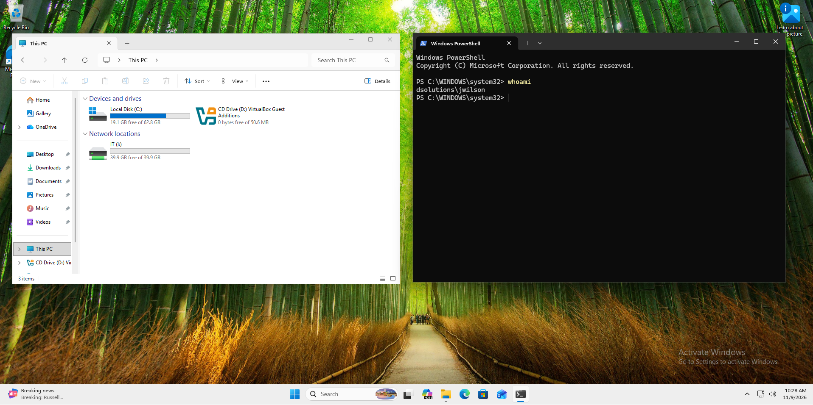
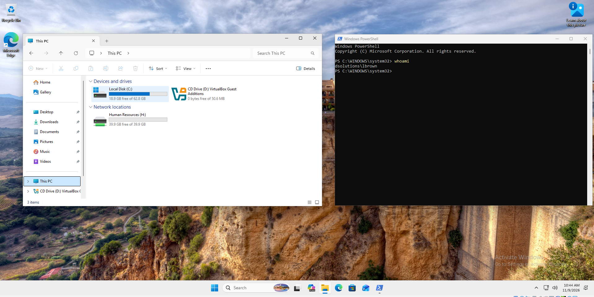

# Windows Server 2025 Enterprise File Server Implementation

**Active Directory | Windows Server 2025 | SMB | NTFS | AGDLP | Group Policy Preferences**

## 1. Project Overview

This project demonstrates the design, deployment, security configuration, and validation of an enterprise file server within a Microsoft Active Directory domain environment.

The solution provides centralized departmental file storage for Finance, Information Technology (IT), and Human Resources (HR), with access controlled through Active Directory security groups and Windows file system permissions.

Group Policy Preferences (GPP) automates departmental network drive mappings based on users' security group memberships.

The project was implemented in a virtualized Windows infrastructure lab to reinforce practical Windows Server administration, Active Directory engineering, identity-based access management, and enterprise troubleshooting skills.

### Project Objectives

- Deploy a dedicated Windows Server 2025 file server.
- Integrate the server into an existing Active Directory domain.
- Configure departmental SMB file shares.
- Implement role-based access through the AGDLP group nesting model.
- Apply appropriate NTFS and SMB share permissions.
- Validate authorized and unauthorized access.
- Automate departmental drive mappings through Group Policy Preferences.
- Test deployment and access behavior from a Windows 11 domain-joined workstation.
- Document implementation evidence and troubleshooting results.

## 2. Infrastructure Environment

| Component | Configuration |
|---|---|
| Active Directory Domain | `dsolutions.local` |
| Domain Controllers | `WIN-DC01`, `WIN-DC02` |
| File Server | `WIN-FS01` |
| File Server Operating System | Windows Server 2025 |
| Client Workstation | `WIN-CL01` |
| Client Operating System | Windows 11 |
| Directory Service | Active Directory Domain Services |
| File Sharing Protocol | SMB |
| Access Control | Active Directory Security Groups, NTFS, Share Permissions |
| Drive Deployment | Group Policy Preferences |
| Virtualization Platform | Oracle VirtualBox |

### Logical Architecture

```text
             dsolutions.local
                     |
       +-------------+-------------+
       |                           |
    WIN-DC01                    WIN-DC02
       |                           |
       +-------------+-------------+
                     |
             Active Directory
                     |
              WIN-FS01
          Windows Server 2025
                     |
          Departmental SMB Shares
                     |
        +------------+------------+
        |            |            |
      Finance        IT     HumanResources
        |            |            |
        +------------+------------+
                     |
       Group Policy Preferences
                     |
                  WIN-CL01
                 Windows 11
```

*Logical representation of the lab infrastructure; not a physical network topology.*

## 3. Active Directory Security Design

### AGDLP Access Control Model

The implementation uses the Microsoft AGDLP security group model to separate user identity membership from resource permissions.

**AGDLP** represents:

- **A — Accounts:** Domain user accounts.
- **G — Global Groups:** Departmental membership groups.
- **DL — Domain Local Groups:** Resource access groups.
- **P — Permissions:** Access rights assigned to the resource.

The access model follows this relationship:

```text
Domain User Account
        |
        v
Departmental Global Security Group
        |
        v
Resource Domain Local Security Group
        |
        v
NTFS / SMB Resource Permissions
        |
        v
Departmental Shared Folder
```

### Departmental Global Groups

| Department | Global Security Group |
|---|---|
| Finance | `GG-Finance-Users` |
| Information Technology | `GG-IT-Users` |
| Human Resources | `GG-HR-Users` |

Domain local resource groups were used as part of the AGDLP permissions design.

This approach supports centralized administration and helps reduce the need to assign permissions directly to individual user accounts.

### Security Principles

The implementation emphasizes:

- Least-privilege access.
- Security group-based authorization.
- Separation of user membership from resource permissions.
- Controlled departmental access.
- Validation of both permitted and denied operations.

## 4. Enterprise File Server Configuration

### Server Deployment

A dedicated Windows Server 2025 member server, `WIN-FS01`, was deployed into the existing `dsolutions.local` Active Directory environment.

The implementation included server preparation, storage configuration, Active Directory integration, and SMB file-sharing configuration.

### Departmental SMB Shares

| Department | UNC Path | Drive Letter |
|---|---|---|
| Finance | `\\WIN-FS01\Finance` | `F:` |
| IT | `\\WIN-FS01\IT` | `I:` |
| Human Resources | `\\WIN-FS01\HumanResources` | `H:` |

The departmental shares provide centralized storage accessible through standard Windows SMB connections.

### NTFS and Share Permissions

Access control was implemented using Windows NTFS permissions and SMB share permissions, with departmental authorization managed through Active Directory security groups.

NTFS permissions govern file and folder operations, while SMB share permissions provide an additional access-control boundary for network connections.

The effective access granted over SMB is constrained by both permission sets.

Authorized and unauthorized access tests were completed for the three departmental shares.

## 5. Group Policy Preferences — Automated Drive Mappings

### Business Requirement

Departmental users should automatically receive the appropriate mapped network drive when signing into a domain-joined Windows workstation.

A Finance user should receive the Finance drive without automatically receiving IT or HR mappings.

The same requirement applies to IT and Human Resources.

### Group Policy Configuration

A dedicated Group Policy Object was created:

`GPO-Departmental-Drive-Mappings`

The GPO was linked to the following test OU:

`dsolutions.local/DSolutions/Users/GPO-Test-Users`

The drive mapping preferences were configured under:

**User Configuration → Preferences → Windows Settings → Drive Maps**

### Drive Mapping Configuration

| Department | Drive | UNC Path | Action |
|---|---|---|---|
| Finance | `F:` | `\\WIN-FS01\Finance` | Update |
| IT | `I:` | `\\WIN-FS01\IT` | Update |
| HR | `H:` | `\\WIN-FS01\HumanResources` | Update |

The **Reconnect** option was enabled for each mapping.

### Item-Level Targeting

Group Policy Preferences Item-Level Targeting was configured to evaluate departmental Global Security Group membership.

| Mapping | Target Security Group |
|---|---|
| Finance | `GG-Finance-Users` |
| IT | `GG-IT-Users` |
| Human Resources | `GG-HR-Users` |

This design allows a single GPO to contain multiple departmental drive mapping configurations while selectively applying each mapping according to group membership.

**Important:** Item-Level Targeting controls drive mapping behavior. Actual access to departmental data remains governed by NTFS and SMB share permissions.

## 6. Testing and Validation

### Test Methodology

Departmental user accounts were temporarily moved into the `GPO-Test-Users` OU to validate GPO processing and security group-based drive mapping behavior.

Tests were performed from the domain-joined Windows 11 workstation `WIN-CL01`.

After validation, the three departmental accounts were returned to their original organizational units.

### Validation Results

| Test Account | Department | Expected Mapping | Result |
|---|---|---|---|
| `mjohnson` | Finance | `F:` | PASS |
| `jwilson` | IT | `I:` | PASS |
| `lbrown` | HR | `H:` | PASS |

### Finance Validation

The Finance user successfully received the `Finance (F:)` network drive.

The IT and Human Resources drive mappings were not present in the validation screenshot.

### IT Validation

The IT user successfully received the `IT (I:)` network drive.

The Finance and Human Resources drive mappings were not present in the validation screenshot.

### Human Resources Validation

The HR user successfully received the `Human Resources (H:)` network drive.

The Finance and IT drive mappings were not present in the validation screenshot.

### Access Validation

Separate SMB/NTFS permission tests confirmed authorized and unauthorized departmental access behavior.

The project also included a Human Resources file deletion test to validate the configured file operation permissions.

**Outcome:** All three departmental drive mappings were successfully validated using existing departmental accounts.

## 7. Troubleshooting Case Study

### Issue: Group Policy Applied but Drive Mapping Was Missing

During initial testing, a dedicated account named `gpotestuser` was added to the Finance Global Security Group and placed in the test OU.

The Finance drive did not appear as expected.

### Investigation

The following diagnostic tools and commands were used:

```powershell
gpresult /r /scope:user
whoami /user
whoami /groups
Get-ADPrincipalGroupMembership gpotestuser
```

Additional investigation included:

- Checking the account's Active Directory group membership.
- Querying group membership against `WIN-DC01`.
- Confirming the logon domain controller.
- Reviewing Kerberos tickets using `klist`.
- Confirming that the drive mapping GPO was applied.

### Findings

- Group Policy Results confirmed the GPO was applied.
- Active Directory queries confirmed membership in `GG-Finance-Users`.
- The user security token, as inspected through `whoami /groups`, did not display the expected domain group memberships.
- Kerberos ticket inspection showed valid authentication tickets.
- The underlying reason for the missing group information in the test account's token was not conclusively identified.

### Validation Approach

To distinguish a broader GPO configuration problem from behavior specific to the test account, three existing departmental users were tested individually.

All three users successfully received their intended departmental drive mappings.

### Engineering Lesson

Successful GPO processing does not automatically prove that every Group Policy Preference item has applied.

When troubleshooting group-targeted preferences, engineers should distinguish among:

1. GPO scope and processing.
2. Active Directory group membership.
3. The user's effective logon security token.
4. Item-Level Targeting evaluation.
5. SMB and NTFS authorization.

**Resolution status:** Departmental drive mapping functionality was successfully validated. The original `gpotestuser` security-token discrepancy remains unresolved and is documented as a separate troubleshooting finding.

## 8. Implementation Evidence

The following screenshots document the Group Policy configuration and client-side validation.

### Group Policy Link



### Finance Drive Configuration



### Finance Security Group Targeting



### All Departmental Drive Mappings



### Finance Client Validation



### IT Client Validation



### Human Resources Client Validation



## 9. Skills Demonstrated

**Windows Infrastructure Engineering**
- Windows Server 2025 deployment and administration.
- Active Directory domain integration.
- Enterprise file server implementation.
- SMB file-sharing administration.

**Identity and Access Management**
- Active Directory security groups.
- AGDLP group nesting.
- Least-privilege authorization.
- Departmental resource access management.

**Group Policy Administration**
- GPO creation and OU linking.
- Group Policy Preferences.
- Security group Item-Level Targeting.
- User-based drive mapping deployment.

**Troubleshooting and Validation**
- Group Policy Results analysis.
- Active Directory group membership investigation.
- Windows security token inspection.
- Kerberos ticket inspection.
- Authorized and unauthorized resource access testing.
- Technical documentation and evidence collection.

## 10. Project Outcome

The Enterprise File Server Project successfully demonstrated a centralized Windows Server 2025 file-sharing solution integrated with Active Directory.

The implementation combined departmental SMB shares, group-based access control, NTFS permissions, and automated drive mappings through Group Policy Preferences.

Finance, IT, and Human Resources drive mappings were successfully validated from a domain-joined Windows 11 workstation.

The project also reinforced the importance of verifying configuration through real user sessions, documenting unresolved findings, and separating Group Policy deployment behavior from underlying resource authorization.

---

**Project Type:** Independent Microsoft Windows Infrastructure Engineering Lab

**Environment:** Windows Server 2025 | Windows 11 | Active Directory Domain Services

**Focus Areas:** Active Directory Engineering, Windows Server Administration, Identity and Access Management, Group Policy, SMB/NTFS Security
